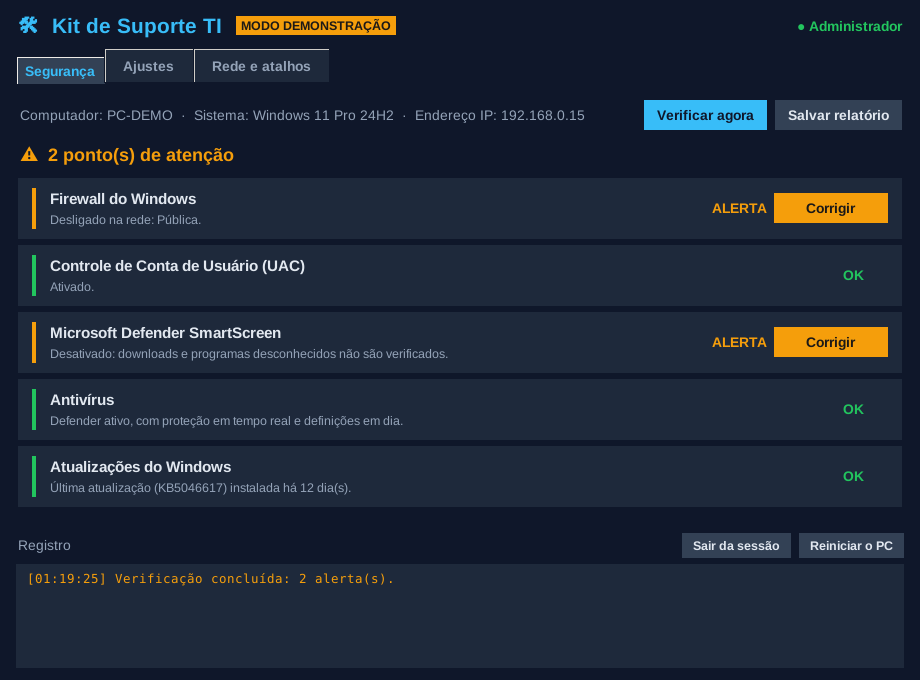
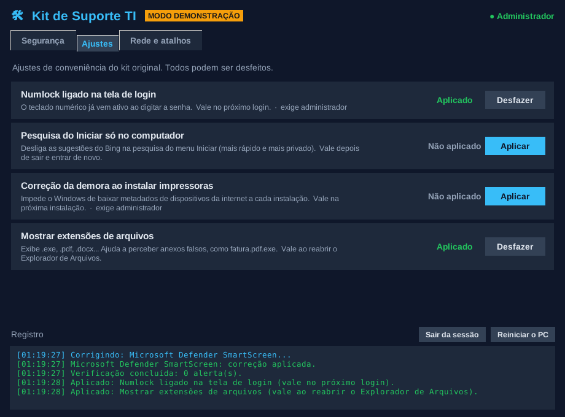
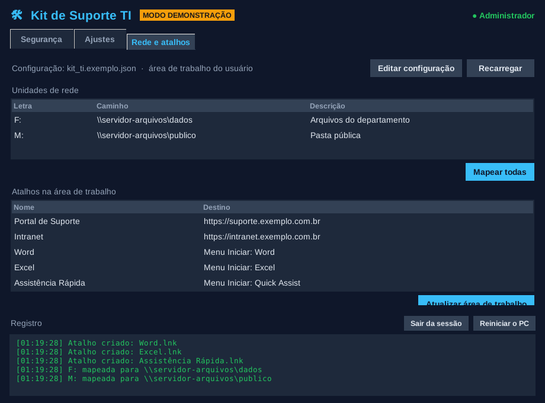

# Kit de Suporte TI para Windows

Ferramenta com interface gráfica para o dia a dia do suporte técnico: verifica se as proteções do Windows estão ligadas, aplica ajustes comuns, mapeia unidades de rede e monta os atalhos da área de trabalho a partir de um arquivo de configuração.

| Segurança | Ajustes | Rede e atalhos |
|---|---|---|
|  |  |  |

## Funcionalidades

**Segurança**
- Verifica **Firewall** (perfis Domínio, Privada e Pública), **UAC**, **SmartScreen**, **antivírus** (Microsoft Defender ou outro registrado na Central de Segurança) e a **última atualização** do Windows.
- Mostra cada item como OK ou ALERTA, com um botão **Corrigir** para religar o que estiver desligado.
- **Salva um relatório** em texto, com nome do computador, sistema, IP e o resultado de cada verificação. Serve para anexar a um chamado.

**Ajustes**, todos com opção de desfazer:
- Numlock ligado na tela de login.
- Pesquisa do menu Iniciar só no computador, sem sugestões do Bing.
- Correção da demora ao instalar impressoras (não baixar metadados de dispositivos).
- Mostrar extensões de arquivos, para perceber anexos falsos como `fatura.pdf.exe`.

**Rede e atalhos**, configurados em `kit_ti.json`:
- **Mapeia unidades de rede** (`net use`), substituindo mapeamentos antigos na mesma letra.
- **Atualiza a área de trabalho**: remove atalhos antigos, cria atalhos de sites (`.url`) e copia atalhos de programas do Menu Iniciar.
- Funciona na área de trabalho do usuário ou na pública (todos os usuários).

**Geral**
- Mostra se o programa está rodando como administrador e, se não estiver, oferece **reabrir como administrador**.
- **Reiniciar** (com 30 s de aviso, cancelável com `shutdown /a`) e **sair da sessão**, sempre com confirmação.
- Registro de tudo o que foi feito na parte de baixo da janela.

## Requisitos

- Windows 10 ou 11.
- Python 3.9 ou mais novo ([python.org](https://www.python.org/downloads/), com Tkinter, que já vem no instalador).
- Nenhuma biblioteca extra: o kit usa `winreg`, `net use`, `netsh` e PowerShell, que já existem no Windows.

## Como usar

```bash
git clone https://github.com/thi-araujo/Script_Windows.git
cd Script_Windows
python kit_ti.py
```

Para usar todas as funções, abra o terminal **como administrador**, ou use o botão **Reabrir como administrador** dentro do programa.

Fora do Windows (Linux/macOS) o programa abre em **modo demonstração**, com um sistema simulado, só para conhecer a interface.

### Configurar unidades e atalhos

Clique em **Editar configuração**. O programa cria `kit_ti.json` a partir de [`kit_ti.exemplo.json`](kit_ti.exemplo.json) e abre o arquivo no editor:

```json
{
  "area_de_trabalho": "usuario",
  "unidades": [
    {"letra": "F:", "caminho": "\\\\servidor-arquivos\\dados", "descricao": "Arquivos do departamento"}
  ],
  "atalhos": [
    {"nome": "Portal de Suporte", "url": "https://suporte.exemplo.com.br"},
    {"nome": "Word", "menu_iniciar": "Word"}
  ],
  "remover": ["Internet Explorer", "Word 2016"]
}
```

- `area_de_trabalho`: `"usuario"` ou `"publica"` (todos os usuários, exige administrador).
- `atalhos`: cada um tem `url` (site) **ou** `menu_iniciar` (nome de um atalho que já existe no Menu Iniciar).
- `remover`: atalhos antigos a apagar da área de trabalho.

O programa valida o arquivo e mostra o que estiver errado (letra inválida, caminho de rede malformado, URL sem `https://`...).

> **`kit_ti.json` fica fora do git** (está no `.gitignore`) porque costuma ter endereços internos da empresa. Não publique esse arquivo.

## Estrutura do projeto

```
Script_Windows/
├── kit_ti.py              # interface gráfica (Tkinter)
├── verificacoes.py        # verificações de segurança e ajustes
├── configuracao.py        # unidades de rede e atalhos (kit_ti.json)
├── sistema.py             # acesso ao Windows (registro, comandos, PowerShell) e sistema simulado
├── kit_ti.exemplo.json    # modelo de configuração
├── tests/
│   └── test_kit.py        # testes com registro e comandos simulados
└── docs/                  # capturas de tela usadas neste README
```

## Testes

Os testes usam um registro e comandos simulados, então rodam em qualquer sistema e não alteram nada no computador:

```bash
python -m unittest discover -s tests -v
```

## Histórico

Este kit começou em 2022 como um menu em `.bat` que usei no suporte de TI para padronizar computadores: atualizar ícones da área de trabalho, mapear unidades, ligar o Numlock e corrigir a instalação de impressoras. A versão antiga também **desativava o firewall, o UAC e o SmartScreen**, prática comum em suporte, mas que deixa o computador vulnerável.

Em 2026 o kit foi refeito em Python, com interface gráfica e testes, e com a lógica de segurança invertida: em vez de desligar proteções, ele **verifica se estão ligadas e ajuda a religar**. Os caminhos e links, que antes ficavam fixos nos scripts, passaram para um arquivo de configuração, e o kit não contém dados de nenhuma empresa. Versões anteriores do mesmo projeto estão em PC-FIT-ALL-IN-ON, Menu_Start_v0.1.2r.bat e MenuStart_v0.1.2r.bat.

## Autor

**Thiago Gomes Araújo**: [GitHub](https://github.com/thi-araujo) · [Portfólio](https://thi-araujo.github.io)
